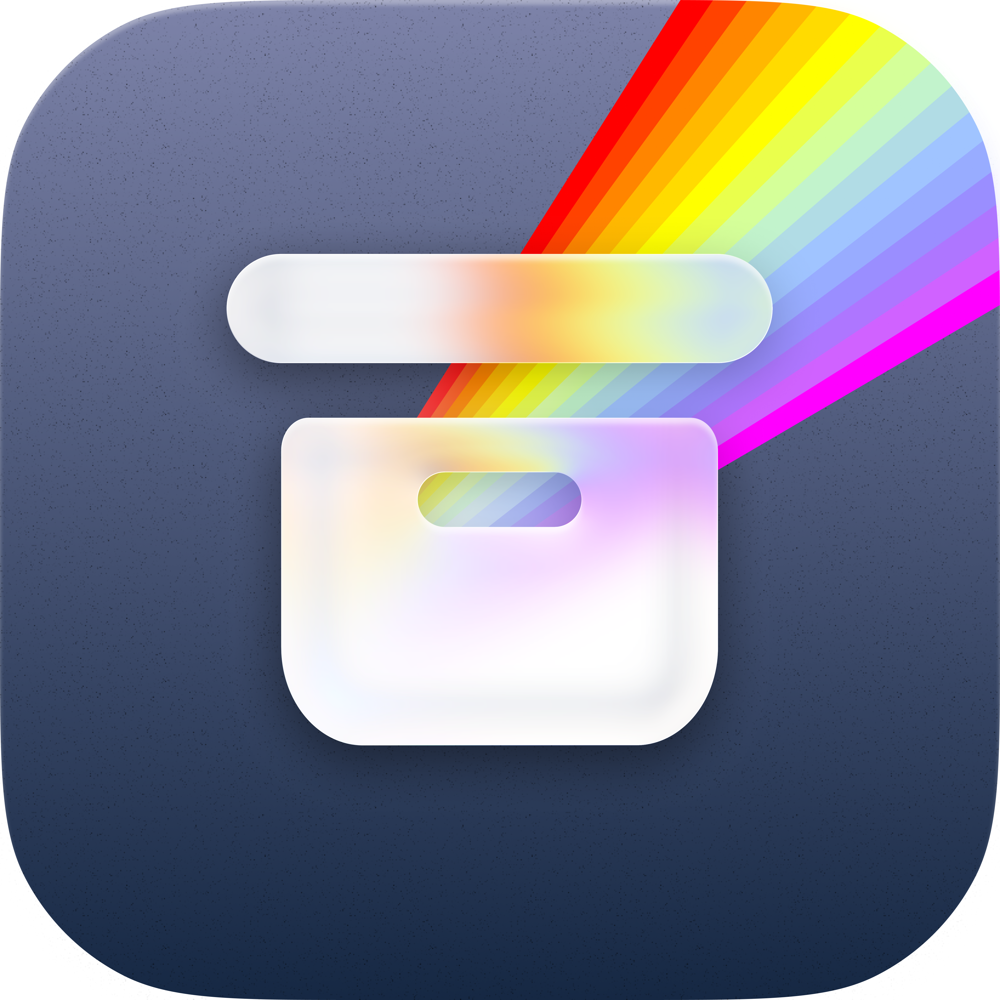
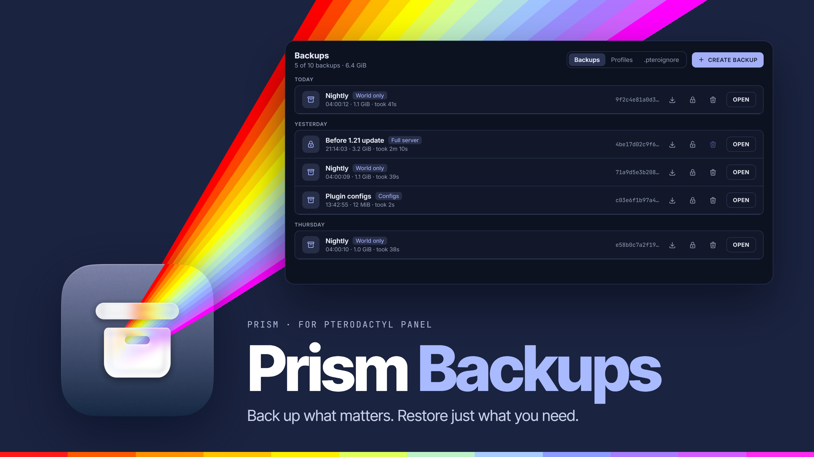
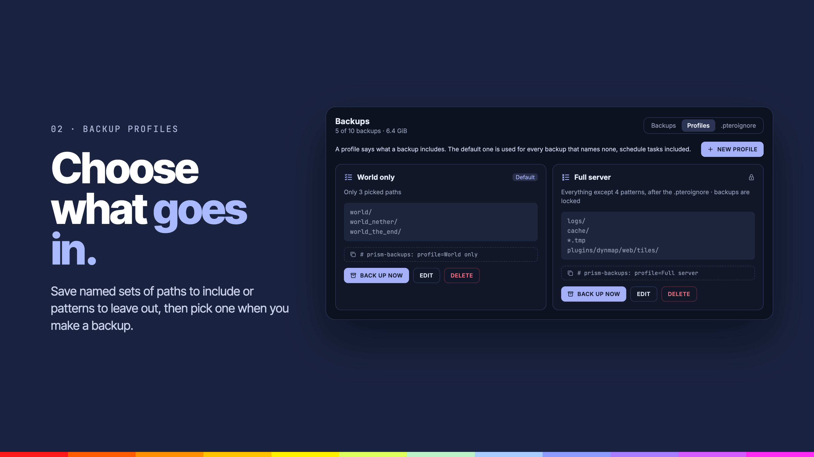
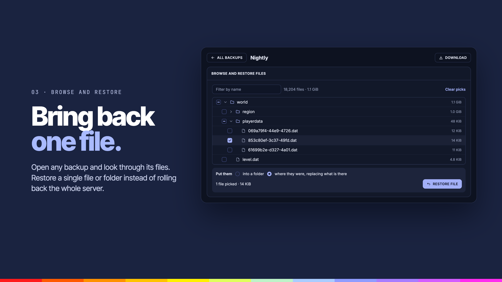
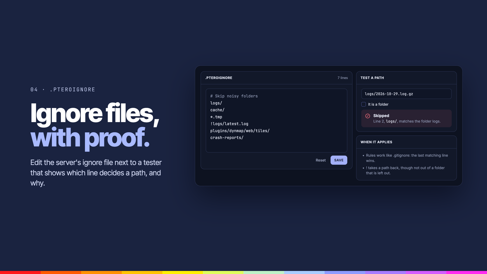

<div align="center">



# Prism Backups

**Backup profiles that choose what gets backed up, browsing inside a backup, restoring single files and a .pteroignore editor.**


</div>

---



## Overview

Prism Backups extends each server's Backups page. Save profiles that decide which files a backup includes, look inside any backup, and restore just the files you need instead of the whole server.

## Features

### Backup profiles



**Choose what goes in.**

- **Backup profiles**: named sets of paths to include and patterns to leave out, picked when you make a backup.

### Browse and restore



**Bring back one file.**

- **Browse inside backups**: open a backup and look through its files.
- **Restore single files**: bring back one file or folder from a backup instead of rolling back the whole server.

### .pteroignore



**Ignore files, with proof.**

- **`.pteroignore` editor**: edit the server's ignore file next to a tester that shows which line decides a path, and why. Rules work like `.gitignore`.

### Also

- **Owners only**: optionally give the extras to server owners only.

## Settings

| Tab | What it covers |
| --- | --- |
| General | Turn it on, owners only |
| Features | Profiles, browsing, single file restore, `.pteroignore` editor |
| Limits | Profiles per server, largest backup to browse, most data per restore, how long downloaded backups are cached |

## Requirements

- Pterodactyl Panel `2.0` with extension SDK `>= 2.0.0-beta.6`
- PHP `8.3`
- [Prism Core](../prism-core) `>= 0.1.0`, installed first
- Node.js and npm, to build the extension

## Getting started

Build the extension against the SDK in the Panel source (`.panel/` at the repo root, see the [main README](../README.md)):

```bash
cd prism-backups
npm install
npm run build
```

Install it on the Panel:

```bash
php artisan p:extension:install /path/to/prism-backups --enable
```

## Development

| Command             | Purpose                 |
| ------------------- | ----------------------- |
| `npm run dev`       | Rebuild on every change |
| `npm run build`     | Build for production    |
| `npm run typecheck` | Check types             |
| `npm test`          | Run the tests           |

Deploy to a Panel running under Portainer from the repo root:

```bash
node --env-file=.env scripts/deploy.mjs --ext prism-backups
```

---

<div align="center">
<sub>Part of <a href="../README.md">Prism</a>. Built for <a href="https://pterodactyl.io">Pterodactyl</a>.</sub>
</div>
