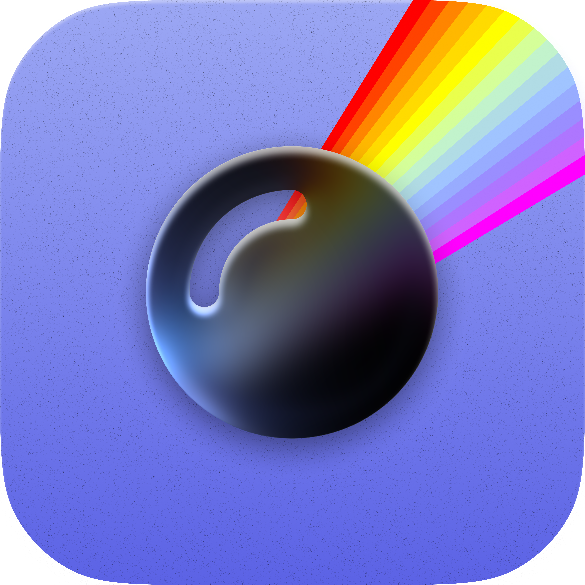
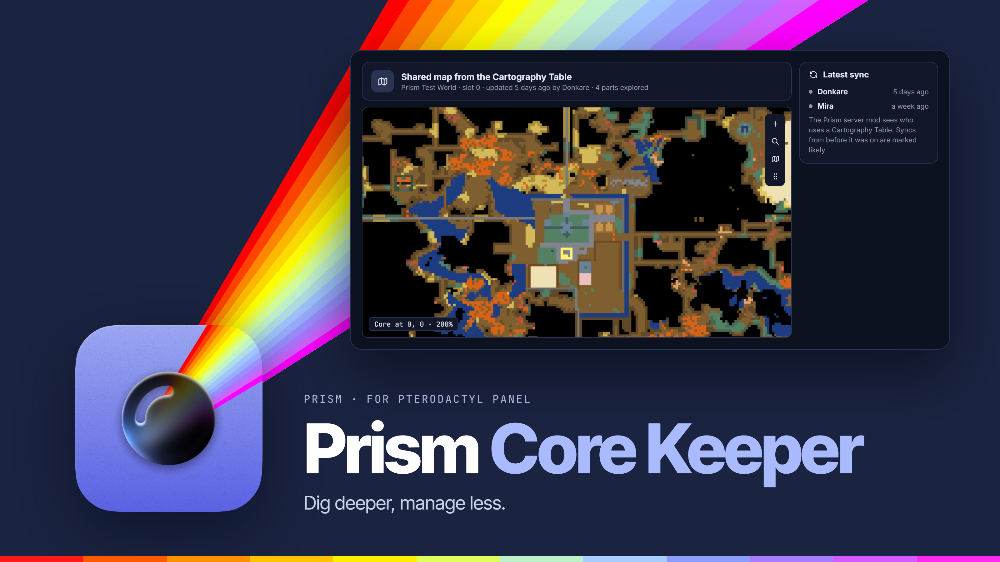
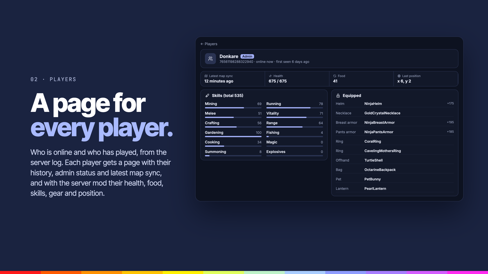
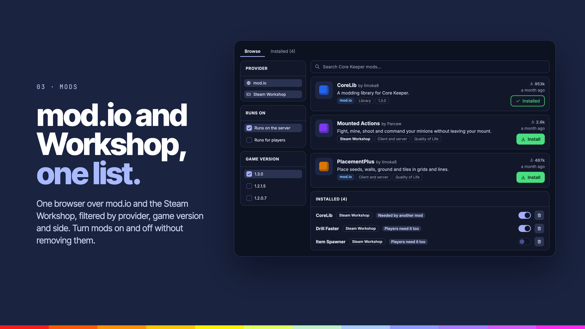
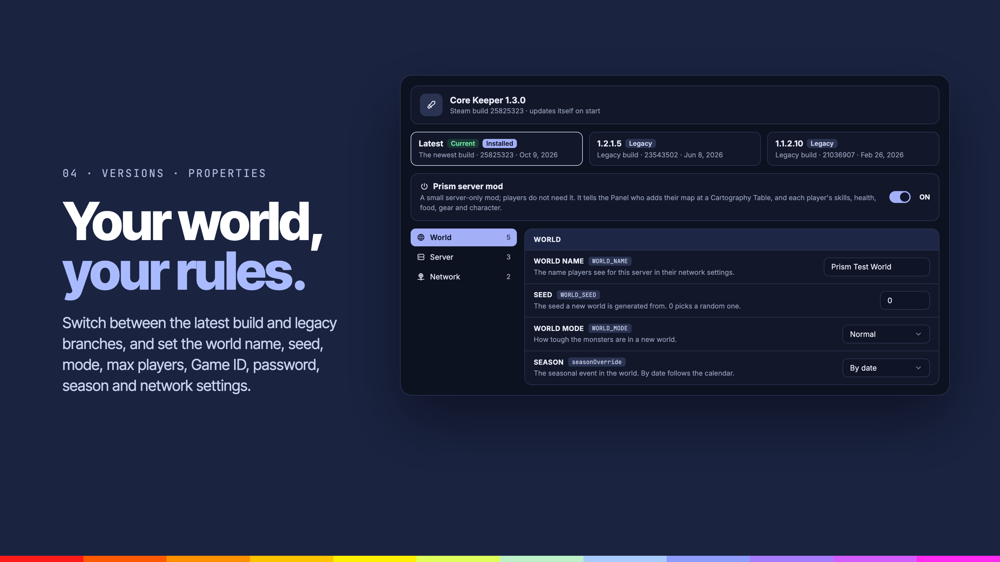

<div align="center">



# Prism Core Keeper

**Players with their own pages, the shared Cartography Table map, mods, Steam builds and properties for Core Keeper servers.**


</div>

---



## Overview

Prism Core Keeper adds Core Keeper tabs to every Core Keeper server. It finds them by egg tag, by the Steam app id (1963720) or by the startup command, so the standard Core Keeper egg works without changes.

## Features

### Players



**A page for every player.**

- **Players**: who is online and who has played, from the server log, with a page per player: history, admin status, their latest map sync and, with the server mod, health, food, skill levels, gear and position.
- **Prism server mod**: an optional mod, turned on per server in Properties, that reports player details and map syncs exactly.

### Mods



**mod.io and Workshop, one list.**

- **Mods**: one browser over mod.io and the Steam Workshop, filtered by provider, game version and side. Turn mods on and off without removing them.

### Versions and properties



**Your world, your rules.**

- **Versions**: switch between the latest Steam build and legacy branches.
- **Properties**: world name, slot, seed and mode, max players, Game ID, password, season and network settings.

Workshop downloads and branch switches run in a short start step added to the server's startup (`.cks/start.sh`).

### Also

- **Map**: the Cartography Table's shared map, as players add to it.

## Settings

| Tab | What it covers |
| --- | --- |
| Server tabs | Show or hide each tab |
| Detection | Egg tags (eggs installing app 1963720 are found anyway) |
| Mods | Confirm before installing, mod.io API key, Steam Web API key |

## Requirements

- Pterodactyl Panel `2.0` with extension SDK `>= 2.0.0-beta.6`
- PHP `8.3`
- [Prism Core](../prism-core) `>= 0.1.0`, installed first
- Node.js and npm, to build the extension

## Getting started

Build the extension against the SDK in the Panel source (`.panel/` at the repo root, see the [main README](../README.md)):

```bash
cd prism-corekeeper
npm install
npm run build
```

Install the latest release on the Panel, from the Panel's directory:

```bash
curl -fLo /tmp/prism-corekeeper.pteroext https://github.com/K3lvin4SY/prism/releases/latest/download/prism-corekeeper.pteroext
php artisan p:extension:install /tmp/prism-corekeeper.pteroext --enable
```

## Development

| Command             | Purpose                 |
| ------------------- | ----------------------- |
| `npm run dev`       | Rebuild on every change |
| `npm run build`     | Build for production    |
| `npm run typecheck` | Check types             |
| `npm test`          | Run the tests           |

Deploy to a Panel running under Portainer from the repo root:

```bash
node --env-file=.env scripts/deploy.mjs --ext prism-corekeeper
```

---

<div align="center">
<sub>Part of <a href="../README.md">Prism</a>. Built for <a href="https://pterodactyl.io">Pterodactyl</a>.</sub>
</div>
