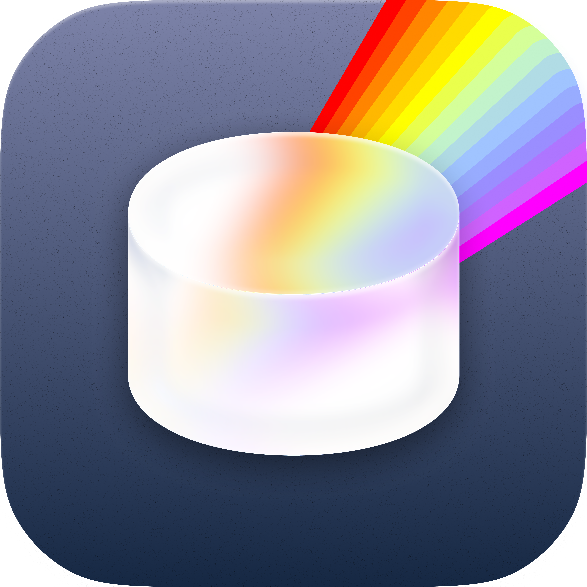
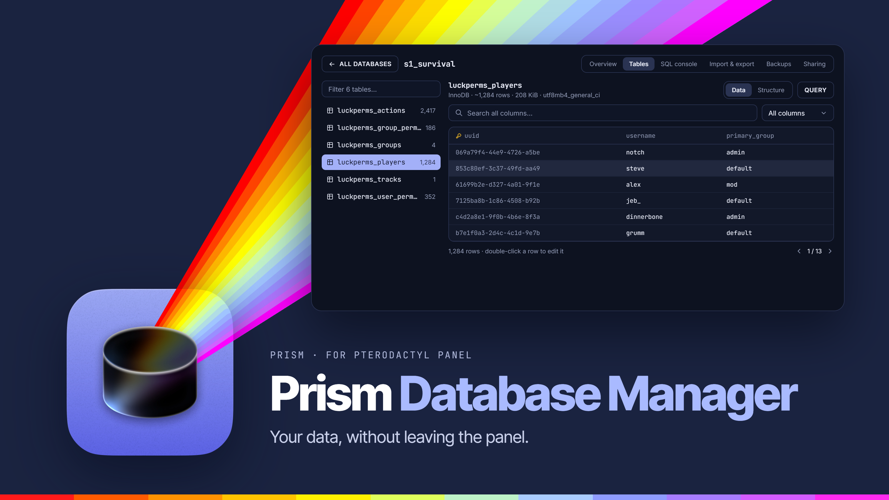
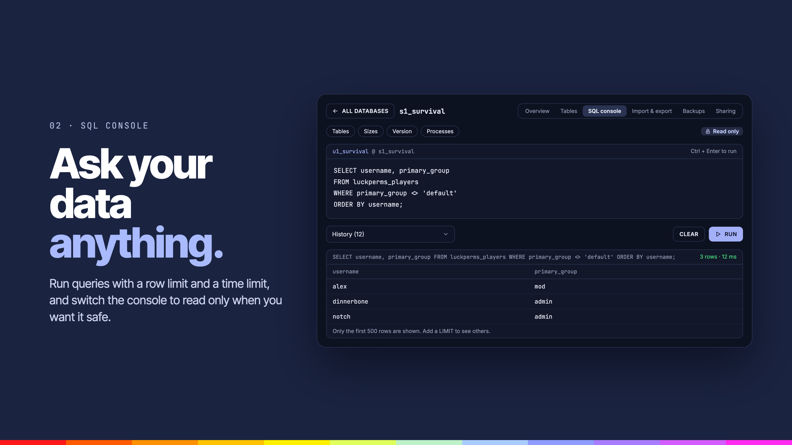
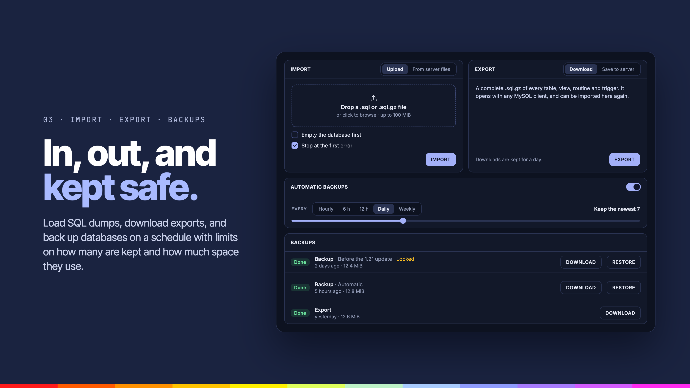
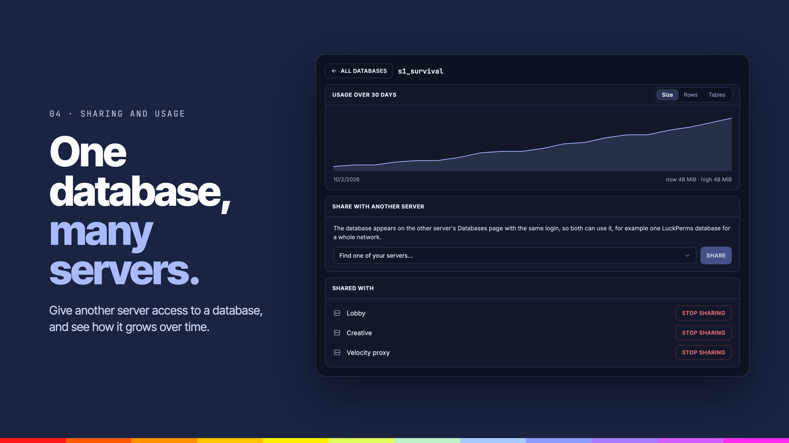

<div align="center">



# Prism Database Manager

**Browse and edit tables, run SQL, import and export data, schedule backups and share a database between servers.**


</div>

---



## Overview

Prism Database Manager replaces each server's Databases page with a full database manager. Browse and edit tables, run queries, move data in and out, and keep backups without leaving the Panel.

## Features

### SQL console



**Ask your data anything.**

- **SQL console**: run queries with a row limit and a time limit, and switch the console to read only when you want it safe.

### Import, export and backups



**In, out, and kept safe.**

- **Import and export**: load SQL dumps and download exports.
- **Backups**: back up databases on a schedule, with limits on how many are kept and how much space they use.

### Sharing and usage



**One database, many servers.**

- **Sharing**: give another server access to a database.
- **Usage history**: see how a database grows over time.

### Also

- **Table browser**: page through rows and edit them in place.

## Settings

| Tab | What it covers |
| --- | --- |
| General | Turn it on, usage history, rows per page |
| SQL console | On or off, read only, rows per result, query time limit |
| Import & export | Largest import, how long exports are kept |
| Backups | On or off, most frequent schedule, backups kept, storage per database |
| Sharing | Sharing between servers |

## Requirements

- Pterodactyl Panel `2.0` with extension SDK `>= 2.0.0-beta.6`
- PHP `8.3`
- [Prism Core](../prism-core) `>= 0.1.0`, installed first
- Node.js and npm, to build the extension

## Getting started

Build the extension against the SDK in the Panel source (`.panel/` at the repo root, see the [main README](../README.md)):

```bash
cd prism-database
npm install
npm run build
```

Install the latest release on the Panel, from the Panel's directory:

```bash
curl -fLo /tmp/prism-database.pteroext https://github.com/K3lvin4SY/prism/releases/latest/download/prism-database.pteroext
php artisan p:extension:install /tmp/prism-database.pteroext --enable
```

## Development

| Command             | Purpose                 |
| ------------------- | ----------------------- |
| `npm run dev`       | Rebuild on every change |
| `npm run build`     | Build for production    |
| `npm run typecheck` | Check types             |
| `npm test`          | Run the tests           |

Deploy to a Panel running under Portainer from the repo root:

```bash
node --env-file=.env scripts/deploy.mjs --ext prism-database
```

---

<div align="center">
<sub>Part of <a href="../README.md">Prism</a>. Built for <a href="https://pterodactyl.io">Pterodactyl</a>.</sub>
</div>
