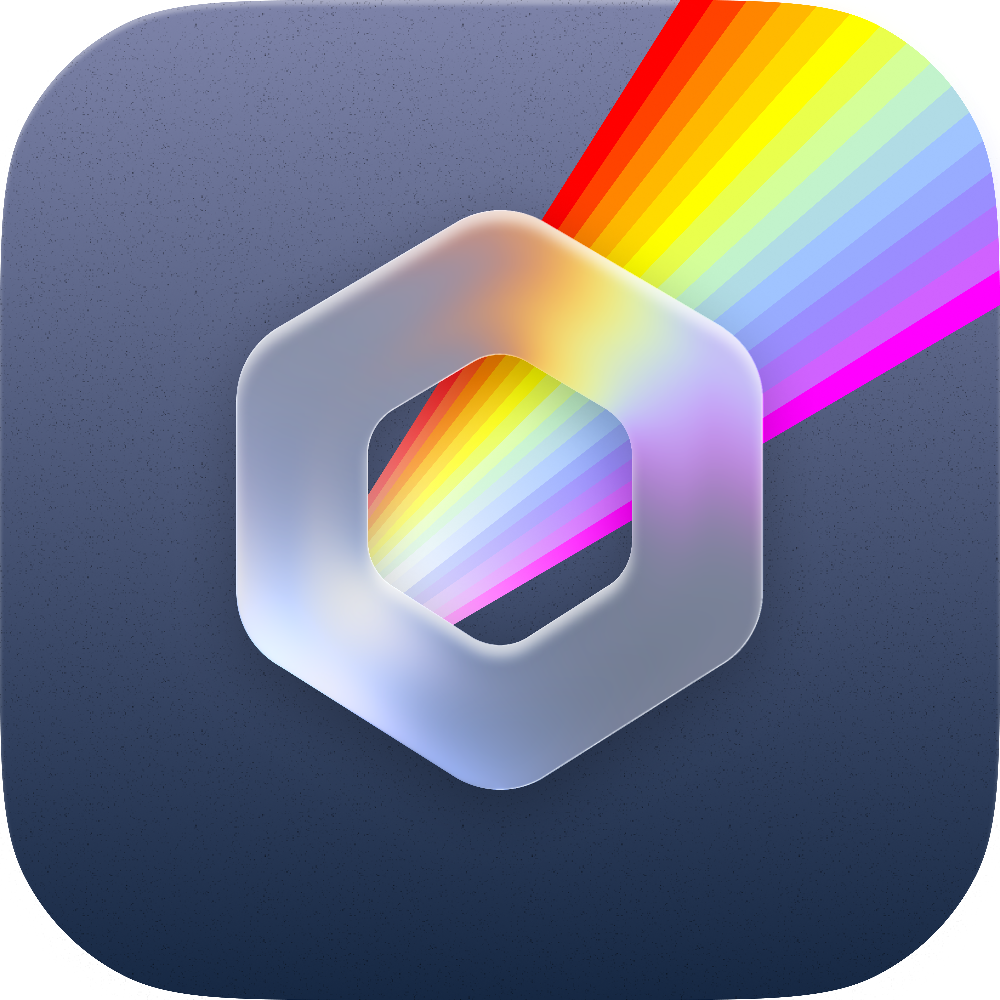

<div align="center">



# Prism Factorio

**Players with admins, bans and the whitelist, mods from the Factorio mod portal, versions and server settings for Factorio servers.**


</div>

---

## Overview

Prism Factorio adds Factorio tabs to every Factorio server. It finds them by egg tag or by a startup command that runs `bin/x64/factorio`, so the standard Factorio egg works without changes.

## Features

- **Players**: who is online and who has played, read from the server's console, with a page per player showing what they said. Kick, ban, make admin, whitelist and message players. On a running server these are the game's own commands; on a stopped one the list files change for the next start.
- **Mods**: search the whole Factorio mod portal for mods with a release for the server's game version, install them with the mods they need (checked against the portal's SHA-1), update them, and turn them on and off in `mod-list.json`. The Space Age expansion's mods can be turned on and off too.
- **Versions**: every headless version there is, the latest stable or experimental version, or a fixed one. Switching reinstalls the server with the egg, which keeps the settings, saves and mods, and can back up the saves first.
- **Properties**: everything in `data/server-settings.json` and the save the server opens. Settings the egg fills in from startup variables on each start (name, description, max players and others) are saved to those variables too.

Mod downloads need a factorio.com username and token: the server's own, from Properties, or one an administrator adds in Prism Properties.

## Settings

| Tab | What it covers |
| --- | --- |
| Server tabs | Show or hide each tab |
| Detection | Egg tags (eggs that start `bin/x64/factorio` are found anyway) |
| Mods | Confirm before installing, a factorio.com username and token for servers without their own |

## Requirements

- Pterodactyl Panel `2.0` with extension SDK `>= 2.0.0-beta.6`
- PHP `8.3`
- [Prism Core](../prism-core) `>= 0.1.0`, installed first
- Node.js and npm, to build the extension

## Getting started

Build the extension against the SDK in the Panel source (`.panel/` at the repo root, see the [main README](../README.md)):

```bash
cd prism-factorio
npm install
npm run build
```

Install it on the Panel:

```bash
php artisan p:extension:install /path/to/prism-factorio --enable
```

## Development

| Command             | Purpose                 |
| ------------------- | ----------------------- |
| `npm run dev`       | Rebuild on every change |
| `npm run build`     | Build for production    |
| `npm run typecheck` | Check types             |
| `npm test`          | Run the tests           |

Deploy to a Panel running under Portainer from the repo root:

```bash
node --env-file=.env scripts/deploy.mjs --ext prism-factorio
```

---

<div align="center">
<sub>Part of <a href="../README.md">Prism</a>. Built for <a href="https://pterodactyl.io">Pterodactyl</a>.</sub>
</div>
