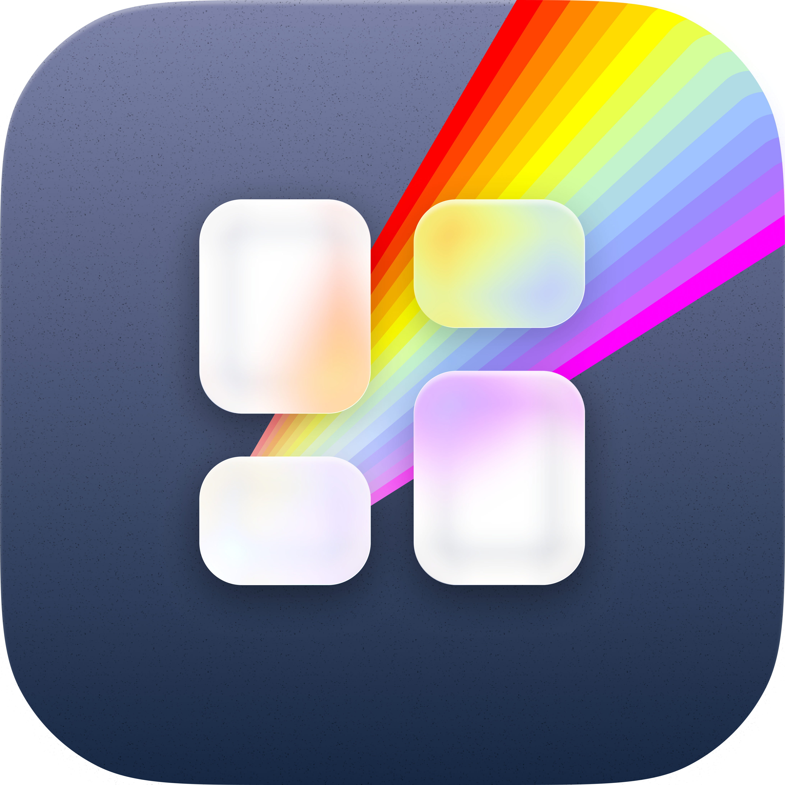
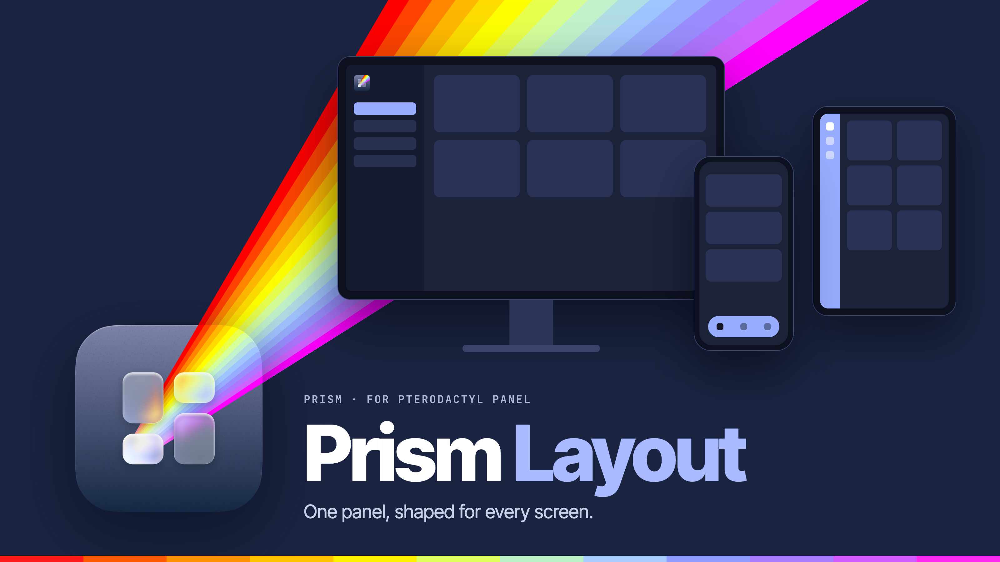
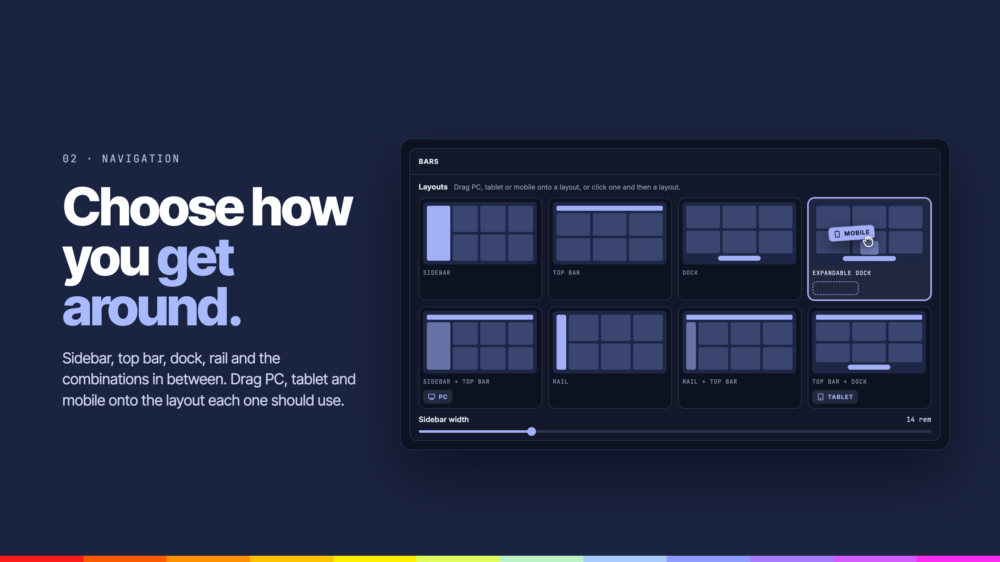
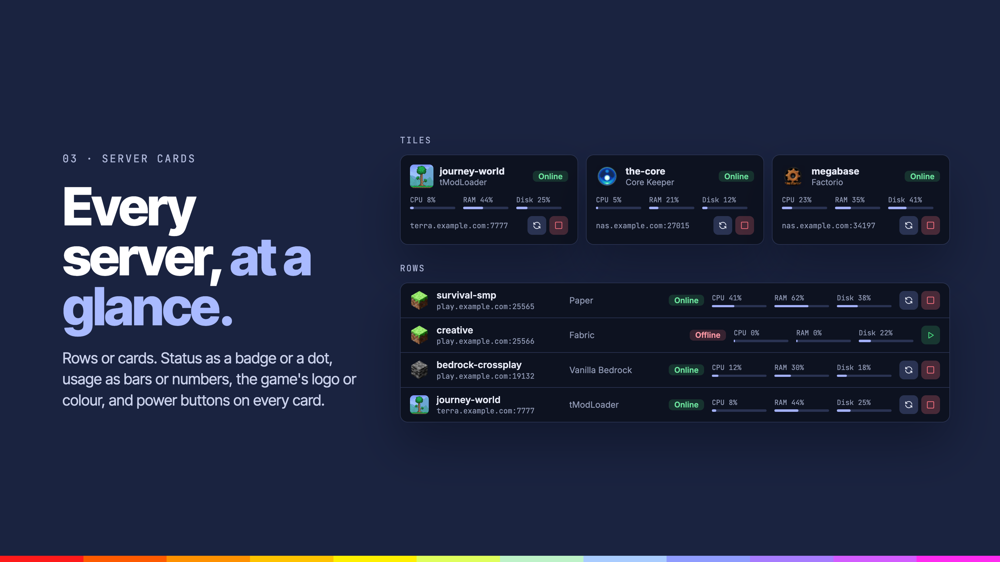
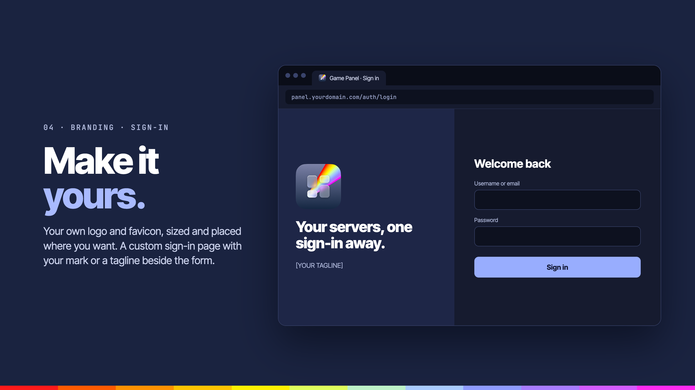
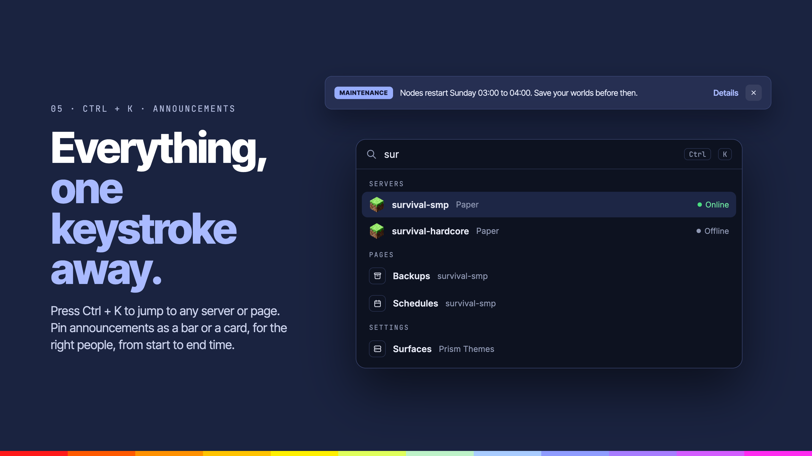

<div align="center">



# Prism Layout

**Seven navigation layouts, server cards, branding, a custom sign-in page, announcements and a Ctrl+K command palette.**


</div>

---



## Overview

Prism Layout changes how the Panel is laid out: the navigation, the dashboard and its server cards, your branding, and the sign-in page. It works with any theme, including [Prism Themes](../prism-themes).

## Features

### Navigation



**Choose how you get around.**

- **Navigation layouts**: sidebar, top bar, dock, expandable dock, sidebar with top bar, rail, rail with top bar, or top bar with dock.
- **Per device**: drag PC, tablet and mobile onto the layout each one should use.

### Server cards



**Every server, at a glance.**

- **Server cards**: rows that line up in columns or tiles (optionally with a picture), status as a badge or dot, usage as bars or numbers, the game's logo or color, and colored power buttons on each card.
- **Dashboard**: an overview with filters above the server list.

### Branding and sign-in



**Make it yours.**

- **Branding**: your own logo and favicon, the logo's size and where it sits.
- **Sign-in page**: card, split or backdrop; on a split page your logo with a bold headline and a tagline beside the form.

### Ctrl+K and announcements



**Everything, one keystroke away.**

- **Ctrl+K command palette**: jump to any server or page from the keyboard.
- **Announcements**: a bar or card with a badge, a kind, audience, link, start and end time, and an optional close button.

### Also

- **Extras**: page width and spacing, a light and dark switch, grouped server pages, a collapsible sidebar, footer links, and the admin area laid out to match.

## Settings

| Tab | What it covers |
| --- | --- |
| Navigation | Layout per device, sidebar width, dock magnify, grouping, server card in the sidebar, light and dark switch |
| Page | Page width and spacing |
| Server cards | Rows or tiles, picture on tiles, status, usage, game logo or color, power buttons |
| Branding | Logo mode, placement and height |
| Sign-in page | Style, mark beside the form, logo size, headline and tagline |
| Announcement | Message, kind, style, audience, link, schedule, dismissible |
| Links | Up to three footer links |
| Advanced | Ctrl+K command palette |

## Requirements

- Pterodactyl Panel `2.0` with extension SDK `>= 2.0.0-beta.6`
- PHP `8.3`
- [Prism Core](../prism-core) `>= 0.1.0`, installed first
- Node.js and npm, to build the extension

## Getting started

Build the extension against the SDK in the Panel source (`.panel/` at the repo root, see the [main README](../README.md)):

```bash
cd prism-layout
npm install
npm run build
```

Install the latest release on the Panel, from the Panel's directory:

```bash
curl -fLo /tmp/prism-layout.pteroext https://github.com/K3lvin4SY/prism/releases/latest/download/prism-layout.pteroext
php artisan p:extension:install /tmp/prism-layout.pteroext --enable
```

## Development

| Command             | Purpose                 |
| ------------------- | ----------------------- |
| `npm run dev`       | Rebuild on every change |
| `npm run build`     | Build for production    |
| `npm run typecheck` | Check types             |
| `npm test`          | Run the tests           |

Deploy to a Panel running under Portainer from the repo root:

```bash
node --env-file=.env scripts/deploy.mjs --ext prism-layout
```

---

<div align="center">
<sub>Part of <a href="../README.md">Prism</a>. Built for <a href="https://pterodactyl.io">Pterodactyl</a>.</sub>
</div>
