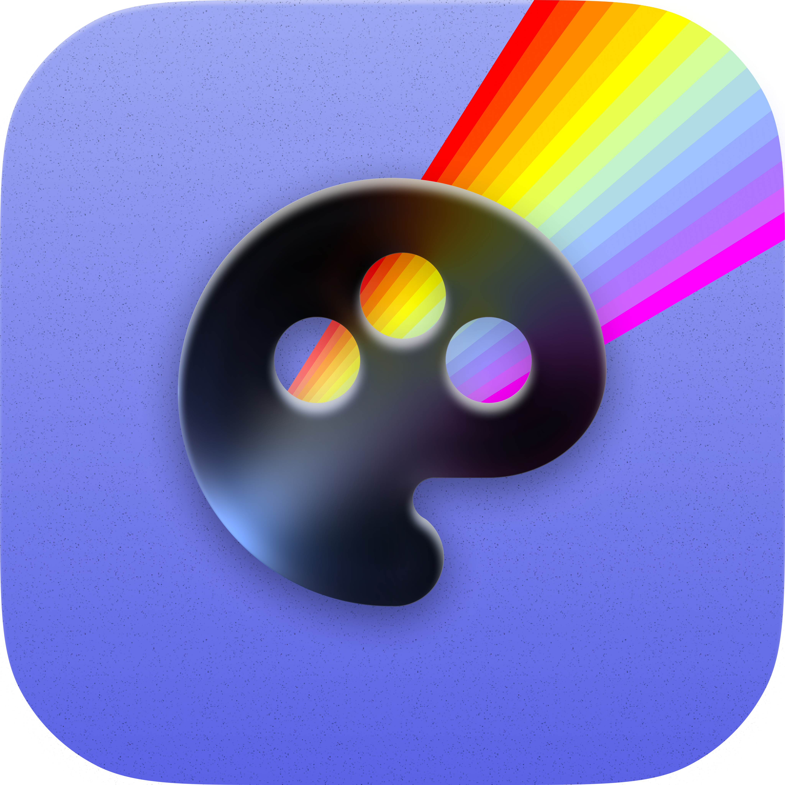
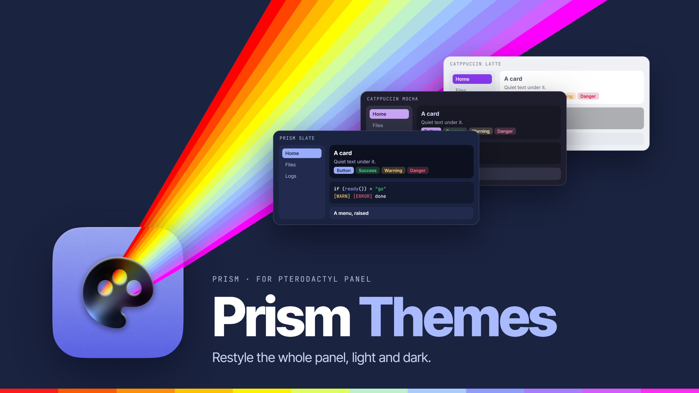
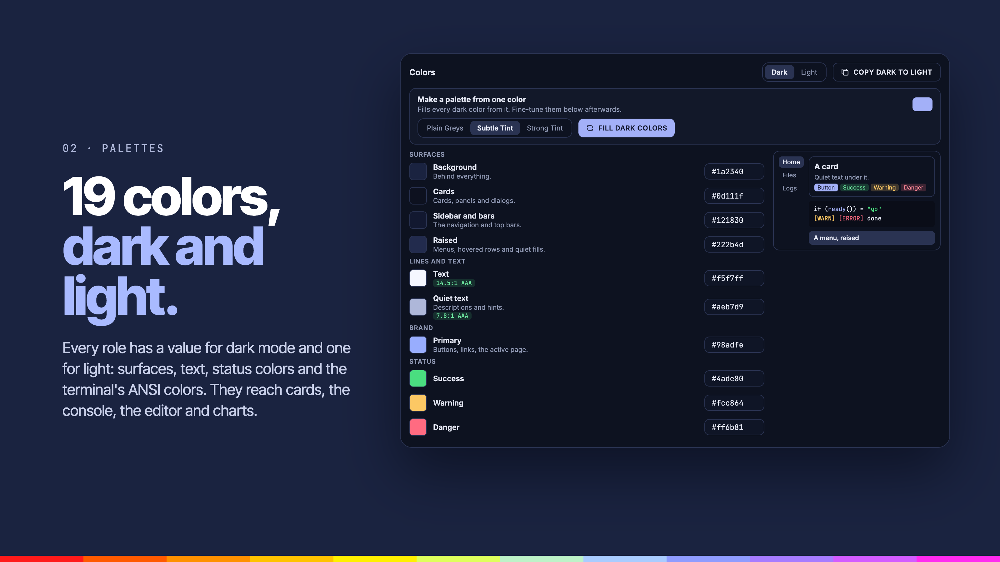
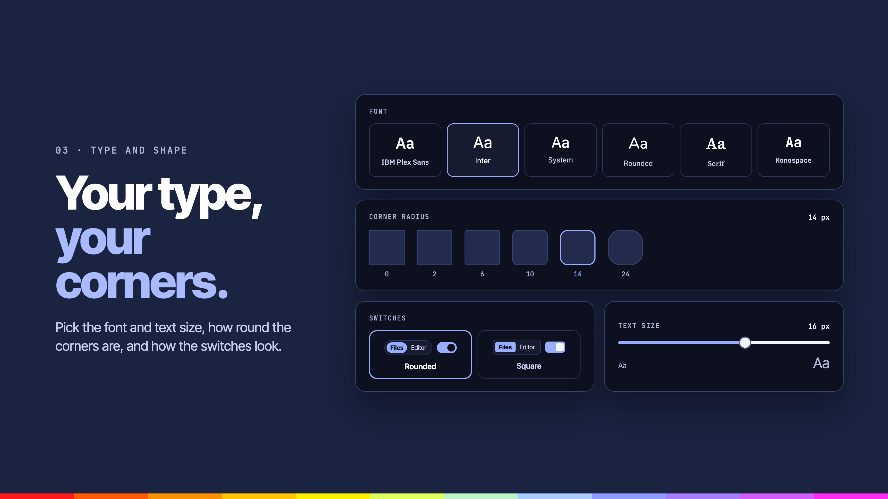
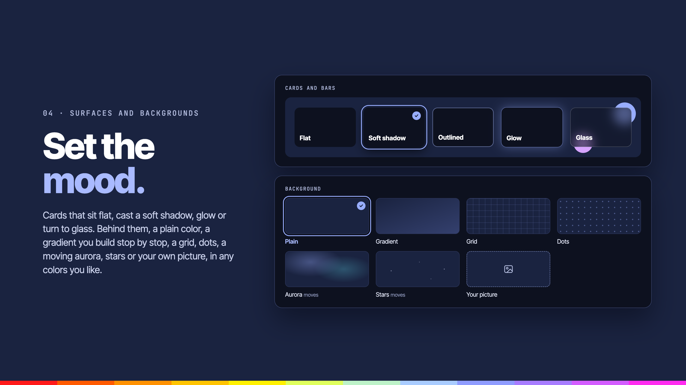
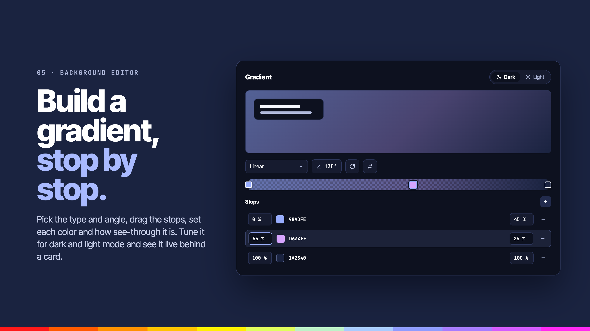
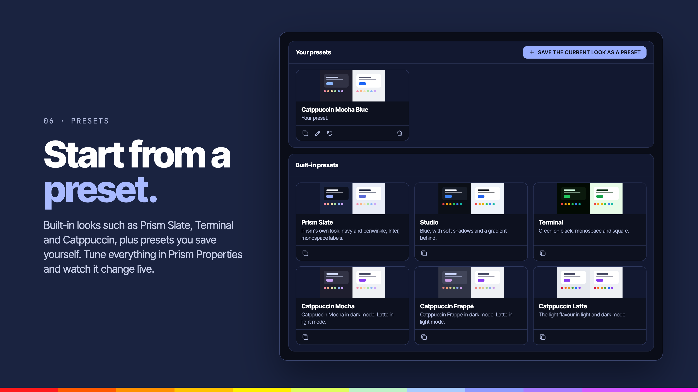

<div align="center">



# Prism Themes

**Colors for dark and light mode, type, shape, surfaces, backgrounds and motion, with presets and your own.**


</div>

---



## Overview

Prism Themes is a Panel **theme**, not a normal extension. It restyles the whole Panel from a set of theme settings and works with any Prism extension, or with none. Its settings are edited in Prism Properties, where you can preview them live. The navigation and page layout are handled by [Prism Layout](../prism-layout).

## Features

### Palettes



**19 colors, dark and light.**

- **Palettes**: 19 color roles each for dark and light mode: background, surface, sidebar, borders, text, primary, status colors and the terminal's ANSI colors. They reach cards, the sidebar, the console, the editor and charts.

### Type and shape



**Your type, your corners.**

- **Type and shape**: font (IBM Plex, system, rounded, serif or mono), text size, corner radius and switch style.

### Surfaces and backgrounds



**Set the mood.**

- **Surfaces**: flat, raised, outlined, glow or glass, with blur and opacity.
- **Backgrounds**: plain, gradient, aurora, waves, stars, mesh, grid or your own picture, with dimming, in any colors you like.

### Background editor



**Build a gradient, stop by stop.**

- **Gradient editor**: pick the type and angle, drag the stops, and set each color and how see-through it is. Tune it for dark and light mode and see it live behind the page.

### Presets



**Start from a preset.**

- **Presets**: built-in looks such as Prism Slate, Terminal and Catppuccin, plus presets you save yourself. Tune everything in Prism Properties and watch it change live.

### Also

- **Motion**: choose how much the interface animates.

## Settings

| Group | Settings |
| --- | --- |
| Palettes | `d_<role>` and `l_<role>` colors (hex or `oklch()`) |
| Type and shape | `font`, `font_size`, `radius`, `switches` |
| Surfaces | `surface_style`, `blur`, `opacity` |
| Background | `background`, `background_image`, `background_dim` |
| Motion | `motion` |
| Presets | `preset`, `presets` |

> Activating a theme changes the Panel for everyone.

## Requirements

- Pterodactyl Panel `2.0` with extension SDK `>= 2.0.0-beta.6`
- [Prism Core](../prism-core) `>= 0.1.0`, installed first
- Node.js and npm, to build the extension

## Getting started

Build the extension against the SDK in the Panel source (`.panel/` at the repo root, see the [main README](../README.md)):

```bash
cd prism-themes
npm install
npm run build
```

Install it on the Panel:

```bash
php artisan p:extension:install /path/to/prism-themes --enable
```

## Development

| Command             | Purpose                 |
| ------------------- | ----------------------- |
| `npm run dev`       | Rebuild on every change |
| `npm run build`     | Build for production    |
| `npm run typecheck` | Check types             |
| `npm test`          | Run the tests           |

Deploy to a Panel running under Portainer from the repo root:

```bash
node --env-file=.env scripts/deploy.mjs --ext prism-themes
```

---

<div align="center">
<sub>Part of <a href="../README.md">Prism</a>. Built for <a href="https://pterodactyl.io">Pterodactyl</a>.</sub>
</div>
